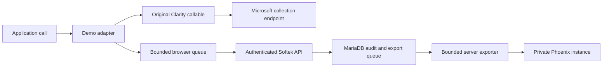

# Plan 017 — Trace Clarity API calls in Phoenix

Plan ID: **017**. Lifecycle: [PROJECT_STATE.md](../PROJECT_STATE.md#plan-status-registry).
Backlog: **B-017**. Depends on the existing consent/collection adapter and Plans
005/010/011/016. Owner authorized implementation on October 14, 2026 (Pacific).
Deploy tracing initially Off; customer collection settings remain unchanged.

## Objective and scope

Give the owner a searchable record in **Arize Phoenix** of each Clarity API call
our application makes, including its argument values and context at invocation.
A shared `Demo()` adapter will invoke Clarity once with the original arguments and
independently queue an audit record for server-side export to Phoenix.

This phase includes the adapter, consent-aware collection of these records, a
durable MariaDB queue, Phoenix export, private Phoenix access, and diagnostic
controls in the existing Admin → Clarity Settings page. Phoenix is a secondary
copy of the application-call audit, not the authority for banking or adoption.

This phase does not observe SDK upload payloads, native mouse/scroll/DOM events,
or Microsoft processing. It does not proxy Clarity, replace its hosted SDK,
change existing event/tag values, or restart the stopped recording investigation.
Raw-upload observation and decoding remain a possible separate plan.

## Baseline before this implementation

- `apps/web/src/analytics.ts` owns SDK initialization, consent, collection gates,
  adoption emissions and feature emissions. The initial callable has a `.q`
  queue; the hosted SDK later replaces it.
- `apps/web/src/feature-context.ts` sends identity and context through an injected
  Clarity callable. `apps/web/src/revision.tsx` emits accepted interaction events
  directly. All application call sites must use the new adapter.
- The browser's consent choice is bound to customer UUID and collection revision
  in sessionStorage; it is not currently a persisted server consent record.
- The API derives human/automation policy and impersonation exclusion in
  `apps/api/src/clarity.ts`. Existing authenticated run/visit and CSRF/origin
  contracts must be reused, without creating visits, rotating banners or writing
  adoption events solely to accept diagnostics.
- `demo` and `demo_test` use MariaDB schema 11; the next migration is 0012.
  Express's current JSON limit is 16 KiB. No Phoenix package/service is installed
  in this project. Check actual host resources and listeners during implementation.

## Implemented design choices

These choices were selected during planning and are implemented. Exact release,
schema, check results and current lifecycle are recorded in PROJECT_STATE.

### Phoenix hosting and access

Use a dedicated self-hosted Phoenix instance on the existing EC2 host as the
initial working choice. Before installation, verify Python/container prerequisites,
available memory/disk and an unused loopback port. Pin a supported release and
record its exact version and deployment method; prefer an isolated environment
and dedicated service identity rather than changing system Python or shared tools.
Set resource limits, persistent storage, restart behavior and scoped health checks.

Phoenix's internal database is SQLite for this small owner-only diagnostic use.
This is Phoenix-owned storage, not a change to the application's MariaDB-only
schema/query contract. No PostgreSQL server or application DB portability is
proposed. Confirm the SQLite option can handle an illustrative 200-customer demo
volume with bounded retention before calling it suitable for the broader cohort.
If this is inadequate, report the measured limitation before expanding hosting.

Bind collector and UI to loopback; owner accesses the UI through an SSH tunnel.
Document an executable tunnel/runbook once the actual port is selected. No public
Phoenix ingress, new DNS record or unrelated Nginx change is needed. API export
uses OTLP/HTTP to the fixed configured loopback collector. Credentials, if used,
remain in a private server environment and never enter the Vite bundle.

### Adapter contract and fidelity

Use `Demo()` as the application's shared invocation function, with a separate
context setter tied to the current customer/run/visit/document. Context is local
metadata; it is not added to Clarity's command arguments. Calls remain conceptually
`Demo('event', 'banner_clicked')` and `Demo('set', 'feature', 'identity-protect')`.

1. Snapshot command/serializable arguments and context at invocation, before later
   object mutation or route/customer changes can alter the record.
2. Invoke the current `window.clarity` exactly once with the original values,
   preserving argument order, the callable's receiver, return value and exception
   behavior. No Promise from Phoenix or the audit API delays this invocation.
3. Queue the diagnostic snapshot independently. Serializer, network and exporter
   failures must not prevent the Clarity invocation or customer navigation.
4. Resolve the current callable each time. Do not replace `window.clarity`, alter
   its `.q`, or wrap the SDK's global with a decorator that disappears on SDK load.
5. Instrument initialization's ConsentV2 call, identity/context, adoption events,
   banner/menu/page/feature interactions, revocation and stop. Preserve existing
   invocation order and backend-confirmed business-event gating.

Record whether the call went to the known pre-SDK queue or the loaded callable,
and whether invocation returned or threw. Neither is a Microsoft receipt.
Sanitize exception details to a bounded code; do not store stack traces or arbitrary
SDK error messages. Calls repeated by the application are separate audit entries;
delivery retries of one audit entry are deduplicated by its stable event UUID.

The supported commands start with `event`, `set`, `identify`, `consentv2`, and
`stop`, matching current source. Validate their precise shapes and allowlisted
events/tags. Log the complete JSON argument array for these supported safe calls,
with no truncation presented as an exact copy. An unexpected command, unsupported
value or oversized snapshot produces a visible diagnostic omission counter;
the original Clarity call still follows the existing application's behavior.
New Clarity commands require an explicit contract update, not arbitrary object
or function serialization. No new high-cardinality per-call Clarity tags are added.

### Consent, ownership and control lifecycle

API-call tracing has a separate build/runtime readiness gate and admin switch,
initially **Off**. It never enables Clarity, grants consent or changes the global
collection revision. When tracing is off, the adapter forwards calls normally and
does not collect audit arguments. Routine development/tests keep both integrations
off unless using explicit local stubs.

Trace only normal authenticated customer activity that is eligible for Clarity
and has granted analytics consent. Exclude login forms, admin pages, impersonation
and ordinary capture-disabled automation. An explicitly permitted automation
diagnostic uses the existing trusted capture contract; a browser-supplied actor
label cannot bypass it. Explain the secondary diagnostic copy in the existing
analytics-consent information when tracing is available.

Add a server-issued diagnostic context bound to the authenticated customer,
run, visit, document, collection revision and tracing revision. It opens only
after explicit grant, recording that grant on the server because the existing
sessionStorage value alone is not a server-side authorization check. The browser
can buffer initial call snapshots while this handshake completes; Clarity startup
must not wait for it. Reuse the current owned visit, never create one as a side effect.

Every batch must revalidate authenticated ownership, diagnostic context, collection
and tracing revisions, actor eligibility and expiry. Derive customer/run/visit/actor
on the server; validate `identify` arguments against the owned identity. Retired
runs, expired sessions, foreign context and changed revisions are refused.

On consent withdrawal, close the diagnostic context and discard unsent activity.
A narrowly defined terminal batch may contain only the prior traced session's
`consentv2` denial and `stop` invocations, and must atomically close that context;
it cannot admit subsequent activity. Global Off and impersonation entry also close
contexts. Never use an old customer's context for new-user stop/initialization calls.
Test shared-browser tabs, logout, switching and policy polling races. Closing the
page or losing authentication can lose a final batch; record that limitation honestly.
Past, validly accepted records remain subject to the diagnostic retention policy.

### Transport, schema and loss visibility

Use same-origin JSON POST with the existing session, origin and CSRF protections.
Proposed routes are `/api/analytics/trace-session` and
`/api/analytics/clarity-calls`; finalize names during implementation. Do not expose
a browser OTLP endpoint or allow the client to select an export destination.

Start with batches of at most 20 calls and an encoded body below 12 KiB, keeping
within the existing 16 KiB parser limit. Flush on a short interval, size threshold
and navigation/visibility changes. Use authenticated `fetch` with keepalive for
best-effort final delivery; do not assume `sendBeacon` can carry the current CSRF
header. Bound in-memory queue size (initial target 250 calls), retries and age.
Do not write arguments into localStorage or create an unbounded offline queue.
Track sequence gaps, rejected/oversized records, dropped calls and failed batches.

Use the committed additive migration **0012_clarity_api_tracing.sql** for tracing
configuration/revision, owned diagnostic contexts and call audit/export records.
Keep audit/export state in the same call row rather than duplicating payloads.
Include stable event UUID; document UUID and sequence; command and exact safe
arguments JSON; client invocation time; server receipt time; queued/loaded outcome;
owned customer/run/visit; collection/tracing revisions; immutable context snapshot;
trace/span IDs; and bounded export attempt/status/error metadata. Index owner/time,
document/sequence and export status/next attempt. Retries with conflicting content
are rejected rather than silently overwriting an existing event.

Audit records are client-observed evidence, separate from `interaction_events`
and adoption tables. Customer reset retains prior diagnostic history within its
retention period; permanent customer deletion removes local owned contexts/audit
rows and prevents pending export. Already exported Phoenix copies are independent
and expire by the Phoenix retention policy; do not imply MariaDB deletion erases
external copies. Recheck deletion/worker races before export and document this limit.
A request already in flight may finish after deletion; a remote copy cannot be
withdrawn by the local SQL transaction.

### Phoenix spans and export behavior

Use explicit custom OpenTelemetry instrumentation on the server; do not install
global LLM or HTTP auto-instrumentation for this task. First prove generic custom
spans and attributes are visible in the pinned Phoenix release. Do not label these
calls as LLM activity or manufacture AI inputs, outputs or cost fields.

One call becomes one short span/trace, with stable IDs persisted before export.
Group/search through document/visit/session attributes without keeping an immortal
parent span open. Include `clarity.command`, `clarity.arguments_json`, call outcome,
client sequence/time, server receipt time, opaque customer/run/visit/document IDs,
route, actor, feature, banner and deployment identifier. Use an explicit isolated
Phoenix project such as `softek-clarity-api`. Diagnostic sampling is 100% of accepted
calls while enabled; exporter sampling must not silently hide records.

A bounded worker exports committed rows, with leases, backoff, timeouts and capped
attempts, recovering after API restart. Start with one worker and small batches;
exporter failures must not block ordinary API requests. Stop/restart/shutdown must
leave unsent rows pending, not mark them exported because they entered SDK memory.
Mark exported only on collector acknowledgment; handle OTLP partial-success/rejection
responses. Ambiguous acknowledgments can produce duplicate exports; keep stable
IDs and disclose that limitation unless pinned Phoenix behavior proves deduplication.

Store no passwords, usernames/email addresses, display names, cookies, auth/CSRF
tokens, form contents, balances or raw DOM. Do not dump request headers or entire
state objects. Validate metadata against the existing bounded analytics vocabulary.
Start with seven-day retention in both stores, with cleanup limited to this new
diagnostic data/project. Verify Phoenix retention support in the pinned version
and provide a scoped cleanup alternative if necessary. Never purge banking history
or other Phoenix projects as part of diagnostic housekeeping.

### Owner-facing controls and evidence labels

Extend Clarity Settings using the shared mobile-first controls. Show tracing
readiness and its independent On/Off switch, pending/acknowledged/failed counts,
oldest pending age, last collector acknowledgment and bounded loss counters.
Provide an authenticated, bounded JSON export of local records under customer,
date and command filters, with correct opaque identities and UTC timestamps.
Document Phoenix SSH access and how to locate an event by its stable ID and session.
No separate Analytics Log page or public Phoenix integration is required here.

Keep these meanings explicit:

| Evidence | What it establishes |
| --- | --- |
| Clarity queue invocation | Our application queued that command for the SDK |
| Loaded-call invocation returned | Our application invoked the loaded callable without a synchronous error |
| Audit accepted | Softek persisted the diagnostic record |
| Phoenix collector acknowledged | Phoenix acknowledged the trace export, not a Microsoft upload |
| Phoenix UI inspected | The recorded call and arguments are actually searchable/readable |

None establishes that Microsoft received an SDK upload, processed an event or
retained a recording. A call-span duration measures local invocation, not Clarity
network time. No fake network-success status is attached to the Clarity call.

## Tasks and acceptance

- [x] PHX-01 — Verify pinned Phoenix/OTel compatibility, generic-span visibility,
  isolated hosting/resources/port and private owner access. Record versions and
  reproducible deployment choices, with no change to Clarity collection.
- [x] PHX-02 — Commit additive migration and strict diagnostic-context/batch
  endpoints; verify ownership, consent/revision/actor rules, limits, retry conflicts,
  reset/deletion behavior and clean/repeat migration on `demo_test`.
- [x] PHX-03 — Implement the shared `Demo()` adapter and route every application
  Clarity invocation through it. Prove arguments/order, initial queue and SDK
  replacement, outcome snapshots and failure isolation. Add bounded delivery and
  terminal control-call handling; no SDK upload interception.
- [x] PHX-04 — Implement explicit custom spans, persisted export IDs and bounded
  durable worker; test acknowledgment/partial rejection, timeout, restart, ambiguous
  retry, retention and shutdown. Configure isolated project with full diagnostic sampling.
- [x] PHX-05 — Add independent admin tracing controls, truthful status/export,
  consent information and Phoenix inspection runbook. Verify mobile/desktop access,
  admin authorization and no tracing of admin/impersonation navigation.
- [x] PHX-06 — Run focused API/migration, adapter and SDK-stub browser acceptance.
  Use an isolated local Phoenix test instance for one real-collector round trip;
  Microsoft endpoints stay blocked. Verify exact safe arguments in Phoenix, existing
  banner/feature/adoption behavior and zero ordinary-test vendor traffic.
- [x] PHX-07 — After implementation authorization, back up retained schema/ledger,
  apply the committed migration to the identified Softek schema and deploy with
  tracing Off. Verify live health and private Phoenix access, then perform scoped
  tracing acceptance only when separately authorized. Document any activation,
  executed checks, losses and rollback; update durable handoff and plan registry.

## Verification details

Adapter checks must compare the exact before/after SDK call sequence, including
ConsentV2 before loader, queue drain and callable replacement. Test mutable argument
snapshot, absent/throwing callable, broken serializer, audit 4xx/5xx/timeouts, queue
overflow and duplicate invocation versus duplicate delivery. No Phoenix failure
may prevent a banner click, menu navigation, CTA, login or confirmed banking action.

API checks must cover strict shapes/size limits, CSRF/origin, anonymous/customer/admin
access, foreign user/run/visit, forged actor/identity, retired run/revision, expiry,
concurrent retries, changed payload conflicts and terminal-context close races.
Rejection must not leak argument values into generic access/error logs.

Browser checks at 360/390/1440px must cover granted/declined/revoked consent,
tracing Off/On without enabling Clarity, ordinary automation exclusion, opted-in
identity/tags/banner/feature events, menu context, refresh, logout/user switching,
impersonation/global Off and preservation of the existing event order/counts.
Tests intercept the hosted script and use a local Clarity stub; real collector
acceptance is isolated from production Phoenix and uses fictional fixtures only.

Inspect a real local Phoenix span, not just an exporter success: confirm the
complete supported argument array, timestamp/sequence, owned context and status
match the MariaDB row and Clarity stub invocation. Stop/restart the collector to
prove the pending queue survives, recovers and reports failure without invented
delivery. Target the expected cohort volume with synthetic calls and no Microsoft
traffic; record measured queue/worker/resource results rather than assuming capacity.

## Deployment, recovery and handoff

Before migration, verify actual host/schema/accounts/status and take a private
backup including the migration ledger. Apply to `demo_test` first; commit numbered
SQL before retained-data application. MariaDB DDL can commit implicitly: use the
existing scoped backup/restore recovery contract after partial failure, never
force a ledger entry or alter an applied migration.

Previous application code can ignore additive tracing tables. To recover, disable
the tracing switch/export worker, restore a compatible application release and
leave diagnostic tables intact. Stop only the project's Phoenix service if needed;
do not remove its data or change Clarity's existing collection settings. Record
that rolling back tracing does not disable existing customer analytics.

Update ARCHITECTURE with implemented choices, PRODUCT with actual diagnostic
behavior, LOCAL_SETUP/TOOLS with verified install/tunnel/cleanup commands and private
configuration locations, TESTING with executable checks, and PROJECT_STATE with
actual versions/release/schema/evidence. Keep all credentials and captures ignored.
Verified setup/inspection and executable checks now live in LOCAL_SETUP and TESTING.
Tracing was deployed Off; live acceptance used owned capture-disabled customers.
No real Microsoft recording pilot was run for this phase.

## References checked for planning

- [Clarity client API](https://learn.microsoft.com/en-us/clarity/setup-and-installation/clarity-api): command shapes and custom call behavior.
- [Phoenix OTEL setup](https://arize.com/docs/phoenix/tracing/how-to-tracing/setup-tracing/setup-using-phoenix-otel): explicit server tracing and export configuration.
- [Phoenix architecture](https://arize.com/docs/phoenix/self-hosting/architecture): collector/UI, SQLite versus PostgreSQL and private deployment choices.

Reverify relevant APIs and pin actual versions during PHX-01. Plan choices such as
retention, batch limits and span grouping are ours; they are not vendor guarantees.
